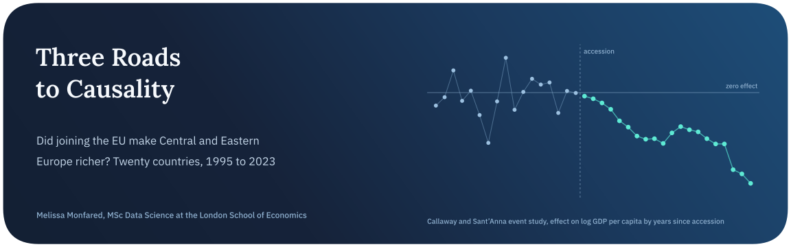
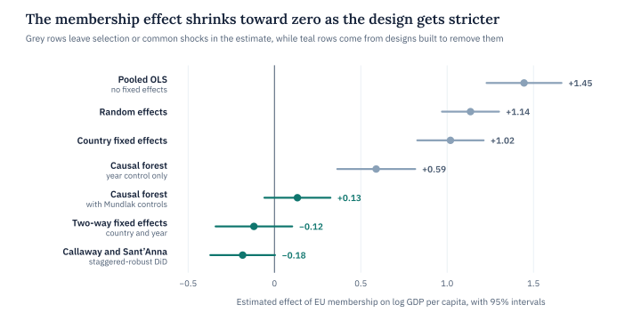
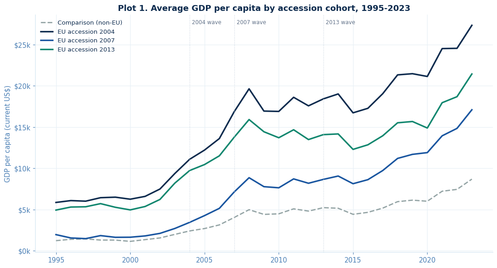
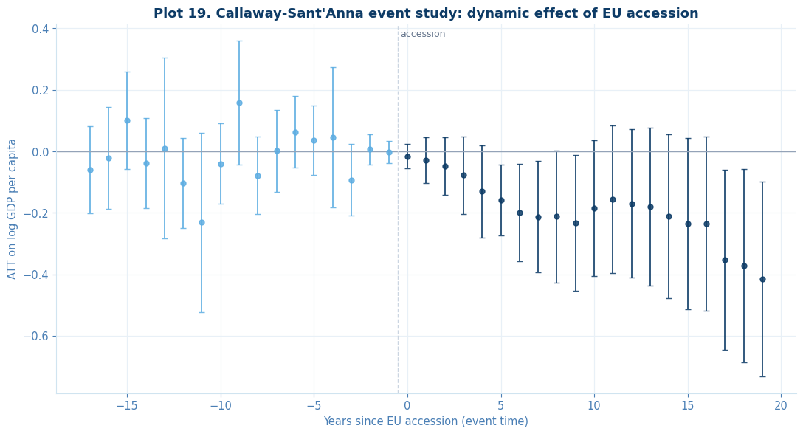

<p align="center">
  
</p>

<p align="center">
  
  
  
  
</p>

Between 2004 and 2013, thirteen countries in Central, Eastern and South-Eastern Europe joined the European Union. Did membership make them richer, and can the data actually show it? The difficulty is that membership wasn’t handed out at random. The countries that joined first had already gone furthest with market reform in the 1990s, so a simple comparison of members with non-members mostly measures who was already ahead.

This notebook takes that selection problem seriously from three directions. A staggered Difference-in-Differences design compares each accession cohort with countries that never joined. An instrumental-variables design tries distance to Brussels as a source of variation in membership, and a regression discontinuity uses the World Bank’s high-income threshold. Around them sits the rest of a full statistical pipeline, from panel econometrics to machine learning, all run on the same twenty-country panel built from live World Bank data.

> **In short.** The raw link between EU membership and income is large, and almost all of it is selection. Once country and year effects are removed, the estimated effect on GDP per capita is close to zero around accession and turns negative in later years, a pattern that coincides with the 2008 to 2014 crises. Poorer countries in the sample grew faster whether or not they joined, which is the convergence any growth comparison here has to account for.

## Key findings

| Finding | Evidence |
| :-- | :-- |
| The raw gap is mostly selection | Pooled OLS puts membership at +1.45 log points of GDP per capita, and country fixed effects only cut it to 1.02. Adding year fixed effects takes it to −0.12 (clustered SE 0.11, p = 0.29) |
| A staggered design finds no growth dividend | The Callaway and Sant’Anna average effect is −0.18 (95% interval −0.37 to 0.00). It stays close to zero for the first few years after accession, then falls to −0.16 at five years and −0.42 at nineteen |
| Poorer countries grew faster regardless | Initial income in 2000 explains 70% of the variation in growth to 2023, with a convergence slope of −0.019 (p < 0.001) |
| Convergence to Germany is not uniform | Of five countries tested, only Bulgaria’s income gap to Germany is stationary (ADF p = 0.04), while Serbia’s has drifted further away |
| Distance to Brussels fails as an instrument | The first-stage F statistic is 1.37 against a rule of thumb of 10, so the 2SLS estimate of −0.04 is reported but not interpreted |
| The discontinuity result is fragile | Crossing the high-income threshold goes with a 4.1-point lower Gini index (bias-corrected p = 0.012), but only 6 observations from 4 countries sit inside the bandwidth below the cutoff |
| Flexible models don’t solve selection | A causal forest with only a year control returns 0.59, far above the fixed-effects estimates, and with Mundlak controls for country averages it falls to 0.13 (p = 0.17) |

<picture>
  <source media="(prefers-color-scheme: dark)" srcset="assets/estimates-dark.svg">
  
</picture>

## Conclusion

The headline answer is that this panel offers no evidence of a lasting growth dividend from EU accession, once the selection behind accession is taken out. Every design that removes it lands within a couple of tenths of a log point of zero, from −0.18 for the staggered Difference-in-Differences to 0.13 for the causal forest with country averages. The designs that leave selection in produce effects between 0.6 and 1.45.

The negative turn in the event study is the result most in need of care. From about five years after accession the estimates are clearly below zero, but for the 2004 cohort that is 2009 to 2014, the window of the global financial crisis and the euro area debt crisis, and several new members, the Baltic states above all, had just been through credit-fuelled booms. These countries were also not the poorest in the sample, so ordinary convergence predicts somewhat slower growth for them than for Albania or Moldova. The event study can’t separate those stories from an effect of membership itself.

Two of the three roads were partly blocked, and the notebook reports them as such. Distance to Brussels barely predicts how long a country has been a member once initial income is controlled for, so the instrument is too weak to support any conclusion. The discontinuity finds a sizeable drop in inequality at the high-income line, with no sign of countries sorting around it (density test p = 0.29), but it rests on a handful of country-years and reads best as a pattern worth testing on more data.

## The data

The panel covers twenty European economies from 1995 to 2023. Thirteen joined the EU, ten of them in the 2004 wave and the rest in 2007 and 2013. The seven comparison countries never joined during the sample period. They are Serbia, Bosnia and Herzegovina, North Macedonia, Albania, Montenegro, Ukraine and Moldova, all post-communist economies in the same region. Germany is fetched as well, but only as the benchmark for the convergence tests.

Every series, from GDP to the Gini index, comes from the World Bank’s World Development Indicators, requested live at run time through a session with retries and backoff. GDP per capita is in current US dollars. The final panel has 577 country-years, after dropping three early years for Montenegro, which had no separate national accounts before 1998.



*Average GDP per capita by cohort. Every accession cohort sits above the comparison group from 1995 onward, nine years before the first accession, which is the selection problem in a single picture.*

## Methods

| Question | Method | Result |
| :-- | :-- | :-- |
| Which panel estimator fits? | Pooled OLS, fixed and random effects, Hausman test | Hausman χ²(2) = 5.0, p = 0.08, with fixed effects kept on economic grounds |
| Are the standard errors trustworthy? | Residual diagnostics, from Breusch-Pagan to variance inflation factors | Heteroskedastic and strongly autocorrelated (DW = 0.27), so errors are clustered by country |
| Do poorer countries catch up? | Beta-convergence regression, 2000 to 2023 | Slope −0.019, R² = 0.70 |
| Is each country converging on Germany? | Augmented Dickey-Fuller tests on the income gap | Only Bulgaria rejects a unit root |
| Can the series forecast itself? | ARIMA trained to 2015 and tested on 2016 to 2023 | Off by 0.38 log points on average |
| Do the two groups lead each other? | Granger causality at one and two lags | No, every p-value above 0.6 |
| What is the effect of membership? | Two-way fixed effects, then the Callaway and Sant’Anna estimator for staggered timing | −0.12 and −0.18, neither clearly different from zero |
| Does geography identify it? | 2SLS with log distance to Brussels as the instrument | Weak first stage, F = 1.37 |
| Does crossing the high-income line matter? | Sharp regression discontinuity with rdrobust, checked with a density test | Gini −4.1 at the cutoff, with no jump in future growth (p = 0.45) |
| Can growth be predicted? | Linear regression and gradient boosting against a naive mean, split by time | Every model has a negative out-of-sample R² |
| Does the effect differ by country? | Causal forest from econml, with Mundlak controls | Average 0.13, with larger estimates further from Brussels |



*The Callaway and Sant’Anna event study with 95% intervals. Before accession the estimates scatter around zero, which is consistent with parallel trends, and from about five years after accession they turn negative.*

## Limitations and next steps

Twenty countries is a small sample for clustered inference and especially for a causal forest, which usually wants hundreds of units. The comparison group shares a post-communist start with the accession countries but not their history, since most of it lived through the Yugoslav wars or their aftermath, and that weighs on every design in the notebook, parallel trends included. GDP per capita is measured in current US dollars, so exchange-rate swings count as growth alongside real output. The discontinuity also uses GDP per capita as a stand-in for the Atlas-method GNI behind the official classification.

Re-estimating with a constant-price income series is the most important next step. Adding trade and foreign investment data would then allow a gravity-style instrument in the spirit of Frankel and Romer, in place of distance alone.

## Running it

All data is fetched live, so the notebook needs internet access. The World Bank series come from their mirrors on GitHub, and country boundaries for the map come from Natural Earth.

```bash
pip install requests pandas numpy scipy statsmodels linearmodels differences rdrobust rddensity econml scikit-learn geopandas matplotlib seaborn
jupyter notebook estimating-the-growth-effect-of-eu-accession.ipynb
```

## Repository

```text
.
├── estimating-the-growth-effect-of-eu-accession.ipynb   data acquisition, panel models, time series, DiD, IV, RDD and causal forests
├── assets/                                               figures used in this README
└── README.md
```

## About

Made by Melissa Monfared, MSc Data Science at the London School of Economics. More projects live on [my website](https://melissamonfared.github.io). I also post notebooks on [Kaggle](https://kaggle.com/melissamonfared) and I’m on [LinkedIn](https://linkedin.com/in/melissamonfared).

Data from the World Bank’s World Development Indicators.
